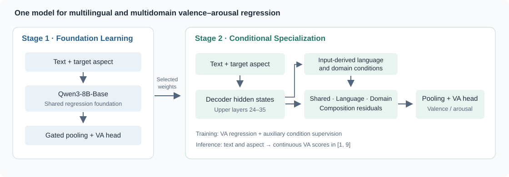

# Unified Multilingual and Multidomain Valence–Arousal Regression

**Beichen Huang · Zongxi Li · Weiming Wang · Haoran Xie · Fu Lee Wang**

Research code accompanying *Unified Multilingual and Multidomain Valence–Arousal Regression*.

[Overview](#overview) · [Results](#results) · [Installation](#installation) · [Training](#training) · [Evaluation](#evaluation) · [Citation](#citation) · [中文](README_zh.md)

## Overview

We study aspect-level valence–arousal regression with one model across languages and domains. The framework separates **Foundation Learning (Stage 1)** from **Conditional Specialization (Stage 2)**. Stage 1 learns a shared regression foundation. Stage 2 continues from its selected checkpoint and adds shared, language, domain and composition residual adapters to the upper decoder layers.



The implementation uses Qwen3-8B-Base. At inference, the model takes **text and a target aspect** and outputs continuous valence and arousal scores in `[1, 9]`. Language/domain condition vectors are derived from input representations; annotated conditions supervise an auxiliary training objective.

## Results

Overall macro RMSE-VA on the 15 evaluation targets; lower is better. Each entry is the mean ± sample standard deviation over seeds **42, 13 and 7**.

| Partition | Stage 1 | Stage 2 | Stage 2 − Stage 1 |
|:--|--:|--:|--:|
| Original | 1.627417 ± 0.015871 | **1.255511 ± 0.008440** | −0.371906 |
| Alternative | 1.574030 ± 0.007299 | **1.211760 ± 0.012674** | −0.362269 |

Per-seed values are in [results/stage_results.csv](results/stage_results.csv), and per-target values are in [results/per_target_results.csv](results/per_target_results.csv). See [experiment details](docs/experiments.md) for partition membership, checkpoint selection and statistical definitions.

## Installation

Tested environment: **Linux, Python 3.11, PyTorch 2.9.0, CUDA 12.8, Transformers 4.56.1**. Reference experiments used NVIDIA H800 GPUs, with one GPU per run.

```bash
conda create -n unified-va python=3.11
conda activate unified-va
python -m pip install -r requirements.txt
python -m pip install -e .
```

Install a PyTorch build compatible with your hardware. Dependencies are pinned in [requirements.txt](requirements.txt).

## Data and pretrained model

Obtain the datasets from the [official DimABSA 2026 repository](https://github.com/DimABSA/DimABSA2026). The experiments use the regression subtask from both DimABSA and DimStance. See [data/README.md](data/README.md) for the expected directory layout and target partitions.

Use a local [Qwen3-8B-Base](https://huggingface.co/Qwen/Qwen3-8B-Base) snapshot at revision `49e3418fbbbca6ecbdf9608b4d22e5a407081db4`.

```bash
export DATA_ROOT=/path/to/DimABSA2026/task-dataset
export MODEL_DIR=/path/to/local/Qwen3-8B-Base
```

Model weights and dataset files are obtained separately. Training and inference use these local paths.

## Training

Train the shared foundation, then continue Stage 2 from that same run:

```bash
python scripts/train.py --stage stage1 --split original --seed 42 \
  --data-root "$DATA_ROOT" --model-dir "$MODEL_DIR" \
  --run-dir runs/original/42/stage1 --device cuda:0

python scripts/train.py --stage stage2 --split original --seed 42 \
  --data-root "$DATA_ROOT" --model-dir "$MODEL_DIR" \
  --parent runs/original/42/stage1 \
  --run-dir runs/original/42/stage2 --device cuda:0
```

For the full three-seed experiment, use the supplied recipe:

```bash
python scripts/reproduce.py --config configs/main_original.yaml \
  --data-root "$DATA_ROOT" --model-dir "$MODEL_DIR" \
  --output-dir runs/original --device cuda:0
```

Use `configs/main_alt1.yaml` and a separate output directory for the alternative partition. Add `--seed 42` to run one seed, or `--dry-run` to inspect the commands. Recipes execute sequentially on the selected device; use fresh output directories.

Training schedules, full hyperparameters and the Baseline comparisons are documented in [configs/README.md](configs/README.md) and [docs/experiments.md](docs/experiments.md).

## Evaluation

```bash
python scripts/evaluate.py --run-dir runs/original/42/stage2 \
  --data-root "$DATA_ROOT" --model-dir "$MODEL_DIR" --device cuda:0
```

Evaluation restores the selected model on the development targets, then reports all 15 test targets. Outputs are written to `<run-dir>/evaluation/`, including `RESULT.json` and per-target predictions.

To aggregate the three paired seeds:

```bash
python scripts/analyze.py compare --split original \
  --left runs/original/{42,13,7}/stage1/evaluation \
  --right runs/original/{42,13,7}/stage2/evaluation \
  --output results/original_comparison.json
```

This produces seed means, sample standard deviations, paired differences and record-cluster bootstrap intervals. Brace expansion in this example uses Bash.

## Prediction

[examples/inputs.json](examples/inputs.json) contains synthetic text/aspect examples.

```bash
python scripts/predict.py \
  --checkpoint runs/original/42/stage2/checkpoints/stage2.pt \
  --model-dir "$MODEL_DIR" --input examples/inputs.json \
  --output predictions.json --device cuda:0
```

## Code structure

```text
configs/                 Experiment recipes and configuration guide
data/                    Dataset preparation guide
assets/                  Framework figure
scripts/                 Training, evaluation, prediction and analysis
src/unified_va/
  engines/               Stage-specific model and optimization implementations
  configs/               Complete stage/partition hyperparameter profiles
  train.py               Training entry and checkpoint selection
  inference.py           Text/aspect inference
  storage.py             Lossless checkpoints and Stage 1 → Stage 2 loading
results/                 Seed-level and target-level experiment summaries
tests/                   CPU model, checkpoint, input and statistics checks
```

| Paper component | Implementation |
|:--|:--|
| Gated pooling and VA regression head | [small_llm_regressor.py](src/unified_va/engines/stage1/src/models/small_llm_regressor.py), [heads.py](src/unified_va/engines/stage1/src/models/heads.py) |
| Language/domain conditions and four residual branches | [backbone_conditional_adapter.py](src/unified_va/engines/stage2/src/models/backbone_conditional_adapter.py) |
| Stage 2 objective and optimization | [train_small_llm_va.py](src/unified_va/engines/stage2/src/train/train_small_llm_va.py) |
| Distribution-preserving selection | [macro_selection.py](src/unified_va/engines/stage2/src/train/macro_selection.py) |
| Record-cluster statistics | [paired_statistics.py](src/unified_va/paired_statistics.py) |

Implementation conventions, numerical precision and checkpoint storage are described in [docs/reproducibility.md](docs/reproducibility.md). For development checks, run `python -m pip install -e '.[test]'` followed by `python -m pytest`.

## Citation

```bibtex
@unpublished{huang2026unifiedva,
  title  = {Unified Multilingual and Multidomain Valence--Arousal Regression},
  author = {Huang, Beichen and Li, Zongxi and Wang, Weiming and Xie, Haoran and Wang, Fu Lee},
  year   = {2026},
  note   = {Manuscript}
}
```

A standalone entry is provided in [CITATION.bib](CITATION.bib).

## License

A software license has not yet been assigned. The pretrained model and datasets are governed by their respective terms.
