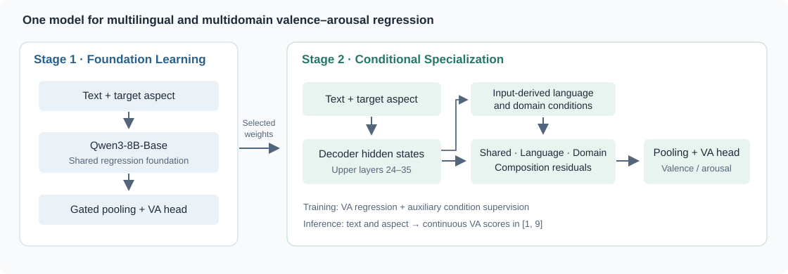

# Unified Multilingual and Multidomain Valence–Arousal Regression

本仓库提供论文《Unified Multilingual and Multidomain Valence–Arousal Regression》的研究代码。
作者：Beichen Huang、Zongxi Li、Weiming Wang、Haoran Xie、Fu Lee Wang。

方法采用两阶段训练：**Foundation Learning（Stage 1）**学习多语言、多领域的共享回归基础；**Conditional Specialization（Stage 2）**从同一选中权重继续训练共享、语言、领域及组合残差分支。推理输入为文本和目标aspect，输出 `[1,9]` 范围的valence与arousal。

| 三种子均值 ± 样本标准差，RMSE-VA越低越好 | Stage 1 | Stage 2 |
|:--|--:|--:|
| 原划分 | 1.627417 ± 0.015871 | 1.255511 ± 0.008440 |
| 替代划分 | 1.574030 ± 0.007299 | 1.211760 ± 0.012674 |

完整安装、训练、评估和预测命令见英文 [README](README.md)。

- [数据准备](data/README.md)：官方数据地址、文件结构及两个划分。
- [实验配置](configs/README.md)：三种子复现入口及完整超参数位置。
- [实验说明](docs/experiments.md)：Baseline、阶段与组件对照、选模及统计。
- [实现细节](docs/reproducibility.md)：训练数值路径、梯度行为、检查点和精度。
- [逐种子结果](results/stage_results.csv)与[逐目标结果](results/per_target_results.csv)。

运行环境为Linux/Python 3.11。模型与数据需按官方条款另行准备。软件许可证尚未指定。
